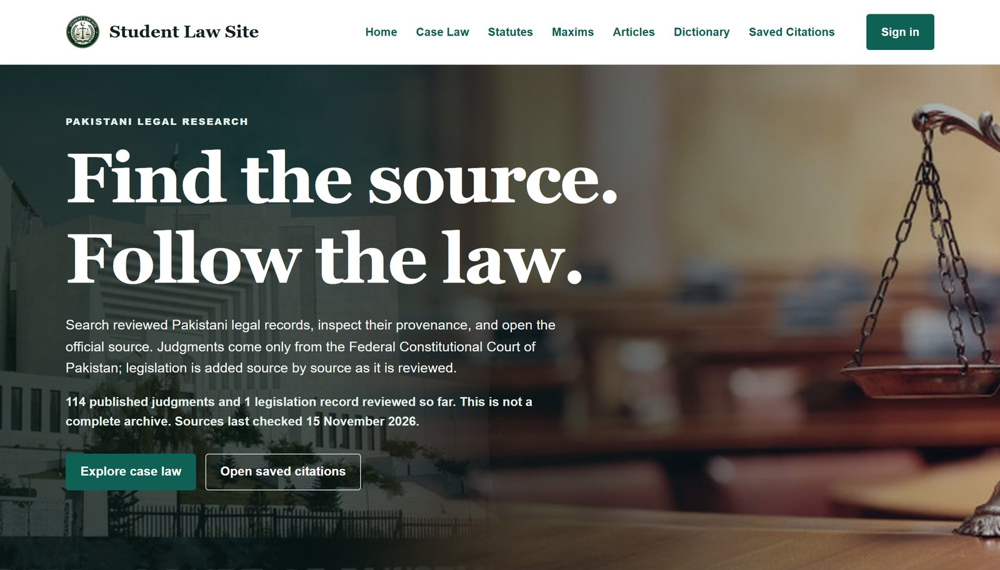
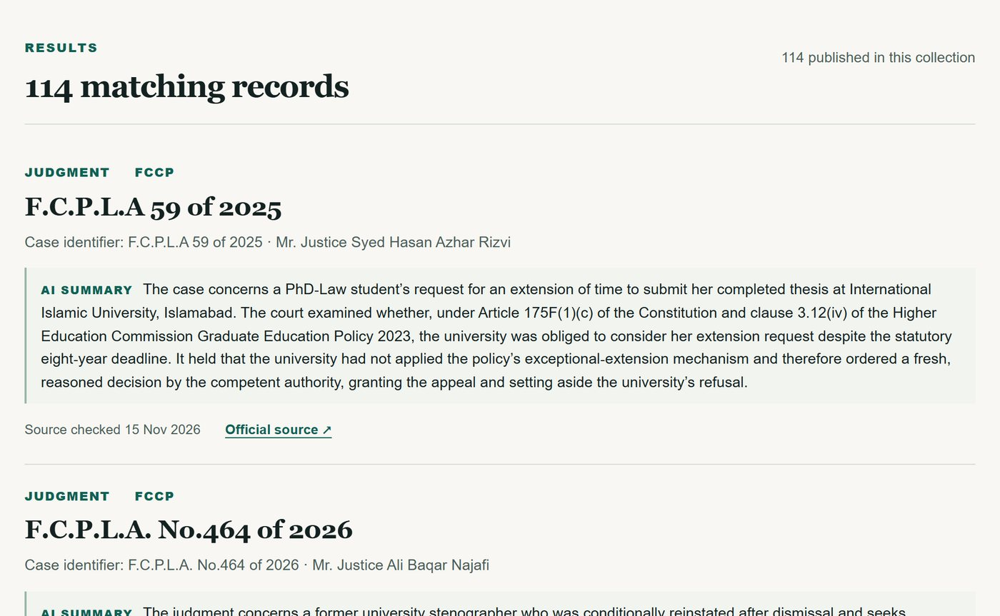
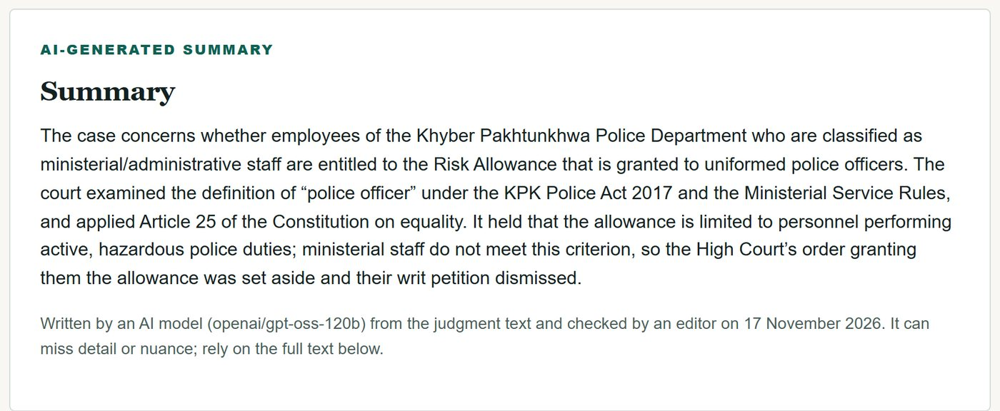
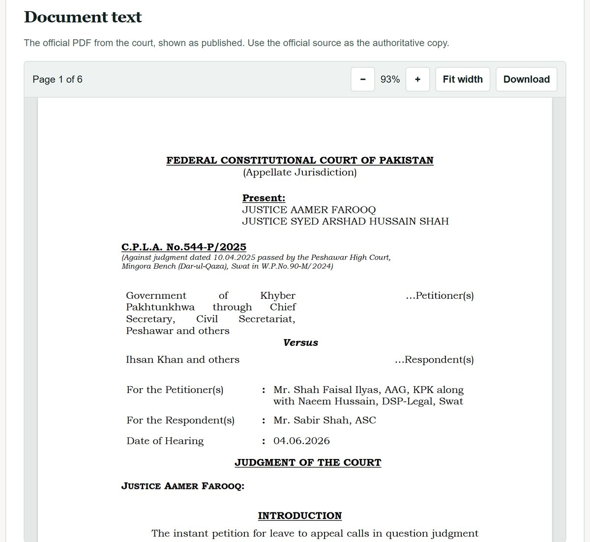
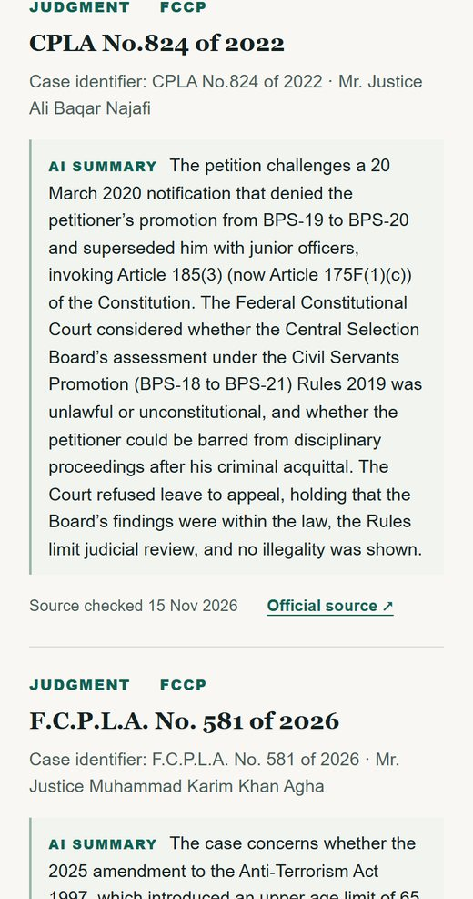
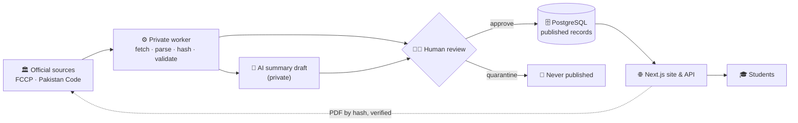

<div align="center">


# Student Law Site

### Find the source. Follow the law.

**Free, source-linked research on Pakistani law for students: official judgments in their original layout, reviewed AI summaries, and an honest record of where every document came from.**

[](https://studentlawsite.netlify.app)
[](https://github.com/MHassanJawad/student-law-site/actions/workflows/ci.yml)


[**Open the site →**](https://studentlawsite.netlify.app) · [How it works](#how-it-works) · [Run it locally](#run-it-locally) · [Documentation](#documentation)

<br />



</div>

---

## What this is

Student Law Site is a research website for Pakistani law students. You can search judgments of the **Federal Constitutional Court of Pakistan (FCCP)** and reviewed legislation, and read each judgment exactly as the court published it. A short summary tells you what the case is about and what the court decided. Every record links back to its official source and shows when that source was last checked.

> **Educational research only.** This site is not legal advice or an official government publication. Always verify a document at its linked official source.

## The problem

Reading Pakistani case law as a student is harder than it should be:

| | What students run into |
| --- | --- |
| 📂 **Scattered, fragile sources** | Judgments sit on court portals that change. When FCCP moved to a new site in November 2026, its old download links stopped working. |
| 📄 **Downloads, not reading** | Official PDFs download as files instead of opening, and copied text loses the court's headings, layout and emphasis. |
| ⏳ **No quick way in** | To find out whether a judgment is even relevant, you have to read the whole thing. There's nothing that says what it decides. |
| ❓ **Unclear provenance** | Unofficial copies rarely say where a text came from, which version it is, or whether it's complete. |
| 🕳️ **False confidence** | Search tools rarely say what they *don't* cover, so an empty result looks like the law is silent. |

## How Student Law Site solves it

<table>
<tr>
<td width="50%" valign="top">

### 🔎 Search that knows its limits
Five search modes: **Case Law**, **Courtwise**, **Citation**, **Advanced** (judge and decision date) and **Statutes**. Results show what was matched and say exactly how much is covered, for example "114 published in this collection", so a gap never looks like an answer.

</td>
<td width="50%" valign="top">

### 🤖 Summaries a human approved
Each judgment gets a short summary of **what the case is about and what the court decided**, not who the parties are. An AI model drafts it, and a human editor reviews it **before it's published**. Summaries are always labelled as AI-written, with the model and the review date.

</td>
</tr>
<tr>
<td colspan="2" valign="top">

### 💬 A research assistant that shows its sources
Sign in and ask a question in plain English. The assistant searches the published judgments, answers only from what it finds, and cites each source. Code checks every citation, quote and case number before an answer is shown, and it declines questions it can't support.

</td>
</tr>
<tr>
<td colspan="2" align="center">

</td>
</tr>
<tr>
<td width="50%" valign="top">

### 📜 The judgment as the court published it
A built-in **PDF.js reader** shows the court's own PDF, with its headings, underlining, small caps and aligned party tables intact. You can select text, zoom, track pages and download. A plain-text version sits underneath and takes over if the PDF can't load.

</td>
<td width="50%" valign="top">

### 🔗 Provenance on every record
Every document shows its **official source link**, the date it was **last checked**, and a **version reference**. Each PDF is fetched from the court's permanent address and **checked against its SHA-256 hash** before it's shown.

</td>
</tr>
<tr>
<td width="50%" align="center" valign="top">

</td>
<td width="50%" align="center" valign="top">

</td>
</tr>
<tr>
<td width="50%" valign="top">

### 📚 Study tools that follow you
Sign in to **save citations**, add notes and folders, and **export** your library. You can delete your account and data at any time. Curated **Maxims**, **Articles** and **Dictionary** collections support learning beyond case law.

</td>
<td width="50%" valign="top">

### 📱 Built for every screen
The site is responsive and accessible, with keyboard navigation and labelled controls. The loading indicator is a scales-of-justice mark that stops animating for people who turn off motion. Every pull request is checked for accessibility at phone and desktop widths.

</td>
</tr>
</table>

<div align="center">

</div>

## How it works

Nothing reaches the public site without a human approving it. A private worker collects from official sources, an operator reviews each record, and only reviewed records are published.



1. **Collect.** The worker reads the court's public listing API at a polite rate, stages new judgments privately, and quarantines any record whose metadata changes.
2. **Extract.** It downloads each official PDF by its permanent, hash-named address, checks the bytes against that hash, and extracts the text layer. Scanned PDFs are held back for OCR.
3. **Summarise.** An AI model (by default `openai/gpt-oss-120b` via Groq) drafts a short summary. Drafts stay in a private table that the public can't read.
4. **Review.** An operator approves or rejects each judgment and each summary from a review CLI.
5. **Publish.** Reviewed records sync to the hosted database. The site serves them, and fetches each judgment's PDF from the court by hash when a reader opens it.

### Trust by design

- **Coverage is stated, not implied.** The site never claims to be a complete archive or to show current law.
- **AI is labelled and gated.** No summary goes live without an editor's approval, and each one names the model that wrote it.
- **The source wins.** Official links sit on every record, and the court's PDF is the authoritative copy.
- **Private by default.** Row-level security keeps drafts, inspections and every user's saved citations private, and CI tests that one user can't see another's data.

## Tech stack

| Layer | Technology |
| --- | --- |
| Web app & API | [Next.js 16](https://nextjs.org) (App Router), React 19, TypeScript |
| Database & auth | [Supabase](https://supabase.com): PostgreSQL with row-level security, Supabase Auth |
| Document reader | [PDF.js](https://mozilla.github.io/pdf.js/) viewer with a text layer |
| Ingestion worker | Node.js, `pdfjs-dist`, Cheerio, Zod |
| AI summaries | Any OpenAI-compatible API (default: Groq, `openai/gpt-oss-120b`) |
| Hosting | [Netlify](https://www.netlify.com) (web), Supabase (database) |
| Quality | Vitest, ESLint, axe-core + Playwright, GitHub Actions |

## Project structure

```text
student-law-site/
├── apps/
│   ├── web/          # Next.js site: pages, API routes, PDF reader
│   └── worker/       # Private ingestion, text extraction, AI summaries, review CLIs, corpus sync
├── supabase/
│   └── migrations/   # Database schema, row-level security, search functions
├── scripts/          # CI checks: latency, accessibility, security, restore drills
└── docs/             # Requirements, design, runbooks, security, privacy
```

## Run it locally

**You need:** Node.js 22, npm, and Docker Desktop (for the local Supabase database).

```bash
# 1. Install dependencies
npm ci --legacy-peer-deps

# 2. Start the local database (skips services this app doesn't use)
npx supabase start -x studio,imgproxy,mailpit,inbucket,storage-api,realtime,edge-runtime,logflare,vector,supavisor,postgres-meta

# 3. Configure the web app with the URL and publishable key from `npx supabase status`
cp .env.example apps/web/.env.local

# 4. Run it
npm run dev        # → http://localhost:3000
```

A fresh database starts with two clearly labelled sample records. Run `npx supabase db reset --local` only on a database you don't mind wiping. See the full [setup guide](docs/SETUP.md) for worker credentials, test accounts and troubleshooting.

<details>
<summary><b>Operator pipeline commands</b></summary>

All of these run against the **local** review database, and refuse a remote one.

| Command | What it does |
| --- | --- |
| `npm run ingest:fccp -- --all` | Read the FCCP listing and stage new judgments privately |
| `npm run review:fccp -- list` / `approve <id> "<note>"` | Review and approve staged judgments |
| `npm run extract:fccp-text -- --limit 50` | Download official PDFs, verify their hashes, extract text |
| `npm run summarize:judgments -- --limit 10` | Draft AI summaries into the private review queue |
| `npm run review:summaries -- list` / `approve <id> "<note>"` | Review summaries before they go public |
| `npm run sync:corpus -- --apply` | Copy reviewed records to the hosted database (upsert only) |

Full procedure: [FCCP ingestion runbook](docs/operations/fccp-ingestion.md).

</details>

## Quality checks

Every pull request runs the full CI gate in [`ci.yml`](.github/workflows/ci.yml):

- ✅ Lint, typecheck, unit tests, and a dependency audit
- ✅ Migrations applied to a fresh database and linted
- ✅ Cross-user isolation, accessibility, latency, and security-header checks
- ✅ Backup and restore drills
- ✅ Production container build and smoke test
- ✅ Secret scan across the git history

## Current limits and roadmap

- **Courts:** judgments come only from the FCCP for now. More courts will be added source by source, once each is reviewed.
- **Search scope:** search matches the full text and summary of judgments that have extracted text. Scanned judgments are matched by title and case number until OCR exists.
- **Scanned PDFs:** these need an OCR step, which doesn't exist yet. Until then they show metadata only.
- **Research assistant:** answers come only from published judgments with extracted text, and it declines anything it can't verify. It is built but not launched: the launch quality threshold is unconfirmed, and a public launch needs a paid model tier.
- **Legislation:** records carry metadata, and their legal status is marked unknown until verified.

## Documentation

| Area | Documents |
| --- | --- |
| Product & design | [Requirements](docs/REQUIREMENTS.md) · [System design](docs/DESIGN.md) · [Tech decisions](docs/TECH_STACK.md) · [API contract](docs/api/openapi.yaml) · [Search semantics](docs/product/search-semantics.md) |
| Operations | [Setup](docs/SETUP.md) · [Deployment](docs/DEPLOYMENT.md) · [Runbook](docs/RUNBOOK.md) · [Environment variables](docs/ENVIRONMENT_VARIABLES.md) · [FCCP ingestion](docs/operations/fccp-ingestion.md) · [Pakistan Code ingestion](docs/operations/pakistan-code-ingestion.md) · [Launch readiness](docs/operations/launch-readiness.md) |
| Security & privacy | [Security](docs/SECURITY.md) · [Data privacy](docs/DATA_PRIVACY.md) · [Roles & permissions](docs/ROLES_PERMISSIONS.md) · [Third-party licences](docs/THIRD_PARTY_LICENSES.md) |
| Testing | [Test plan](docs/TEST_PLAN.md) · [Testing guide](docs/TESTING.md) |
| Contributing | [Contributing](CONTRIBUTING.md) · [Commit convention](COMMIT_CONVENTION.md) · [Changelog](CHANGELOG.md) |

## Contributing

Contributions are welcome. Read [CONTRIBUTING.md](CONTRIBUTING.md) and the [commit convention](COMMIT_CONVENTION.md), open a pull request against `main`, and make sure CI passes.

## License

No licence has been chosen yet, so all rights are reserved by the owner. Judgment texts and PDFs belong to their issuing courts. Each record links to its official source.

<div align="center">
<br />
<sub>Built for Pakistani law students · <a href="https://studentlawsite.netlify.app">studentlawsite.netlify.app</a></sub>
</div>
