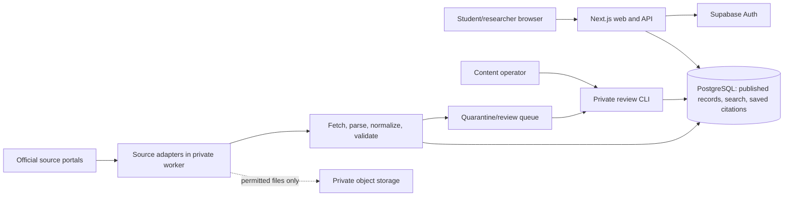

# System design

Phase 1 baseline, 2026-09-27. See [requirements](REQUIREMENTS.md), [stack decisions](TECH_STACK.md), [roles](ROLES_PERMISSIONS.md), and [API contract](api/openapi.yaml). Architecture: modular web application plus a separate ingestion worker around PostgreSQL. This is simpler to operate than microservices and keeps slow source processing outside student requests.

## Boundaries and flow

The source portals, Auth host, and any object store are external. The web app never receives source-adapter credentials or database service-role keys. The worker runs by schedule or private manual trigger. It checks the source register before each source is enabled; a disabled source cannot be fetched by normal jobs.

## Acquisition and publication workflow

1. For each approved source, an adapter enumerates index pages, feeds, or a documented API, and records the source item URL/ID and discovery time. For portals without a reliable machine path, a controlled operator file/link import uses the same validation pipeline. Students never enter database rows manually.
2. Before enabling retrieval, check robots/access rules, terms, any issuing-authority prohibition, and a conservative per-host rate. Use conditional requests where available, bounded concurrency, backoff for 429/5xx, and a resumable cursor. No CAPTCHA bypass or login scraping.
3. Fetch item/PDF, retain canonical URL, HTTP metadata, hash, source field values, and retrieval time. Store original bytes only when permitted; otherwise retain link and derived metadata/text as allowed.
4. Parse HTML/PDF, then normalize without overwriting raw values. The first slice handles embedded text; scanned PDFs go to review until an OCR path is evaluated. An upload date is never silently converted to decision date.
5. Upsert by `(source_id, source_item_id)` when stable; otherwise canonical URL, with hash as a change detector. Conflicting IDs or fuzzy matches become review candidates. Unchanged hashes do not create new versions.
6. Validate required provenance, type, language, date/citation fields when present, text quality, and document status. Stage first; publish only passing records. Material corrections and removals create versions/events and may require operator review. A missing source item is not automatically deleted.
7. Record added/changed/unchanged/quarantined counts, errors, duration, and last successful check. Display source and checked date publicly; never call legislation current without evidence.

## Data model

UUID primary keys and `timestamptz` audit fields are used throughout. Text is UTF-8. Tables are normalized around source, document, version, and subtype; search-vector columns are derived indexes, not canonical data. Migrations in Phase 2 define the exact SQL and are validated on a clean database.

| Table | Core columns and constraints | Main indexes/relations |
| --- | --- | --- |
| `source_registry` | `id uuid PK`, `code text UNIQUE NOT NULL`, `owner`, `root_url`, `jurisdiction`, `material_kind`, `access_status` (`disabled/approved`), `display_status`, `attribution`, `reviewed_at`, `refresh_interval`, `last_checked_at` | Source code and status; referenced by documents/runs. Default disabled. |
| `legal_documents` | `id uuid PK`, `source_id FK NOT NULL`, `source_item_id`, `canonical_url NOT NULL`, `kind` (`judgment/legislation`), `title NOT NULL`, `language`, `published_at`, `publication_status` (`staged/published/quarantined/withdrawn`), `current_version_id`, `created_at`, `updated_at` | Unique `(source_id, source_item_id)` where ID exists; unique `(source_id, canonical_url)`; kind/status/date; full-text title. |
| `judgment_metadata` | `document_id PK/FK`, `issuing_court` constrained to `FCCP`, `case_number`, `decision_date`, `author_judge`, `bench`, `parties`, `case_type`, `raw_citation`, `normalized_citation` | Citation trigram/exact, case number, decision date, judge. |
| `legislation_metadata` | `document_id PK/FK`, `jurisdiction`, `instrument_type`, `instrument_number`, `instrument_year`, `enactment_date`, `effective_date`, `source_status`, `version_label` | Jurisdiction/type/year/status indexes; no inferred current status. |
| `citation_aliases` | `id uuid PK`, `document_id FK`, `raw_value`, `normalized_value`, `source_kind`, `review_status`; unique `(document_id, normalized_value)` | Exact and trigram normalized citation. |
| `document_versions` | `id uuid PK`, `document_id FK`, `content_hash`, `source_version`, `source_date`, `checked_at NOT NULL`, `raw_metadata jsonb`, `extracted_text`, `text_kind` (`source/extracted/ocr/none`), `quality`, `parser_version`, `file_pointer`, `review_status`; unique `(document_id, content_hash)` | Document/version order, full-text text; immutable after publication except review metadata. |
| `document_sections` | `id uuid PK`, `version_id FK`, `section_key`, `heading`, `body`, `sort_order`, `confidence`; unique `(version_id, section_key)` | Version/order; stable anchors only after validation. |
| `topics` / `document_topics` | Curated topic `id/name/slug`; join has `document_id`, `topic_id`, `provenance`, `confidence`, `review_status` | Unique slug and document/topic pair. |
| `editorial_entries` | `id uuid PK`, `kind` (`maxim/article/dictionary`), `slug`, `title`, `body`, `language`, `author`, `source_url`, `status` (`draft/published/archived`), `published_at`, audit fields; unique `(kind, slug)` | Kind/status/date and text search. |
| `profiles` | `id uuid PK/FK auth.users`, `role` (`student/operator`) default `student`, `created_at`, `updated_at` | Role is server-managed. |
| `saved_citations` | `id uuid PK`, `owner_id FK NOT NULL`, `document_id FK NOT NULL`, `citation_snapshot NOT NULL`, `note`, `folder`, `created_at`, `updated_at`; unique `(owner_id, document_id)` | Owner/date and owner/folder; RLS owner only. |
| `ingestion_runs` / `ingestion_events` | Run: source, start/end, status, cursor, counts. Event: run, document/source URL, type, reason, payload reference, actor, timestamp. | Source/time and run/type for audit/review. |

`legal_documents.current_version_id` references a published version of the same document, enforced in application transaction/trigger. Delete source records only by explicit retention policy; withdrawal hides them from search while retaining provenance. Account deletion removes owned saved citations. Source files live outside row storage.

## Search semantics

- Judgment, Courtwise, Citation, and Advanced modes all query FCCP documents only. Courtwise filters only source-verified FCCP bench/unit metadata; missing bench remains an explicit unknown, never a fabricated court.
- Statutes queries legislation only and exposes jurisdictions/types/statuses observed in published records. Year means instrument year; a date range uses documented field names.
- Normalize whitespace and case for text/citations, preserve original Unicode and raw citation, and escape user input for safe parameterized full-text/trigram queries. Phrase search uses quoted terms; unsupported syntax returns a validation error.
- Citation lookup accepts free text or a complete reporter/year/page triplet. The screenshots also show court, judge, lawyer, and party inputs; court is fixed to FCCP here, and other fields become filters only after the pilot proves that metadata is reliably present. Unsupported reporter abbreviations remain searchable as raw text, without implying a complete reporter index.
- Rank exact citation or case-number matches above title and text matches; provide excerpts only from indexed text. Stable sort is score, verified date descending, then ID. Empty queries require at least one usable filter; page size defaults to 20, maximum 100.
- Every response includes a coverage summary/link and a `checkedAt` value where known. Ambiguous citation results are returned as multiple candidates with an ambiguity flag.

## Page flows and design system

Mobile-first shell: Home, the five search entry points, editorial sections, Saved Citations, and account action. Use semantic landmarks, visible focus, text labels, 44 px touch targets, and status announcements. Breakpoints: 640 px for two-column search/results and 1024 px for a side filter panel. Project-owned components use system sans-serif for UI/body and Georgia for document headings, with a 16 px body base and 1.5 line height. Initial tokens: background `#F8F7F3`, surface `#FFFFFF`, text `#142121`, accent `#0E6154`, muted text `#4B5D59`, border `#D5DDDA`, error `#A2252A`, and spacing 4/8/12/16/24/32 px. Verify foreground/background contrast in implementation and adjust tokens if any state fails WCAG 2.2 AA. Do not copy screenshot branding.

| Page | Component hierarchy and states |
| --- | --- |
| Home | Scope/disclaimer, five search links, recent verified judgments/laws/editorial entries, coverage link; honest empty collections. |
| Search | Query form, mode-specific available filters, result count, result cards/table, pagination; loading, validation, no results, source-gap, and service-error states. |
| Document detail | Title/citation, provenance/version banner, metadata, section navigation/text, official source link, save action; unavailable text and extraction-quality notice. |
| Editorial | Kind list/search and published detail; source/author/date metadata; empty state. |
| Account/saved | Sign-in/recovery, saved list, note/folder when enabled, remove action; auth expiry and duplicate-save feedback. |
| Operator | Private CLI initially: run history, quarantine list, review decision with reason; later UI only if needed. |

## Security, privacy, and deployment

Server-side schema validation, parameterized queries, security headers, rate limits, non-PII logs, request IDs, bounded responses, and content sanitization apply at boundaries. Saved citations require both authenticated route authorization and RLS. Public search reads only published records. Source URL redirects and downloaded files must be restricted to approved hosts and size/types to prevent SSRF and resource exhaustion. Operator CLI uses separate credentials and audit logging. A threat-model review will revisit SSRF, malicious PDFs, account ownership, and stale/misleading legal text before source adapters are enabled.

Local Phase 2 environment is Docker Compose plus pinned dependencies and repeatable migrations. Staging/public topology, backups, region, and cost are selected after pilot size and traffic measurements; no production uptime claim is made for free-tier infrastructure. Initial deployment must fit the owner's below-PKR-10,000/month limit or return for a scope/cost decision.
